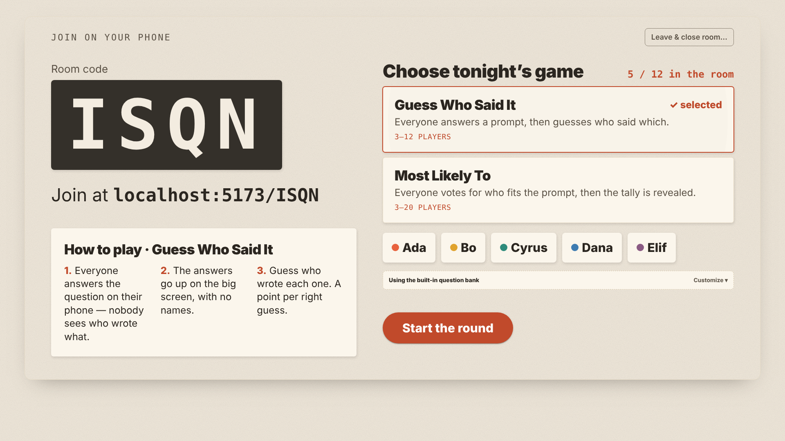
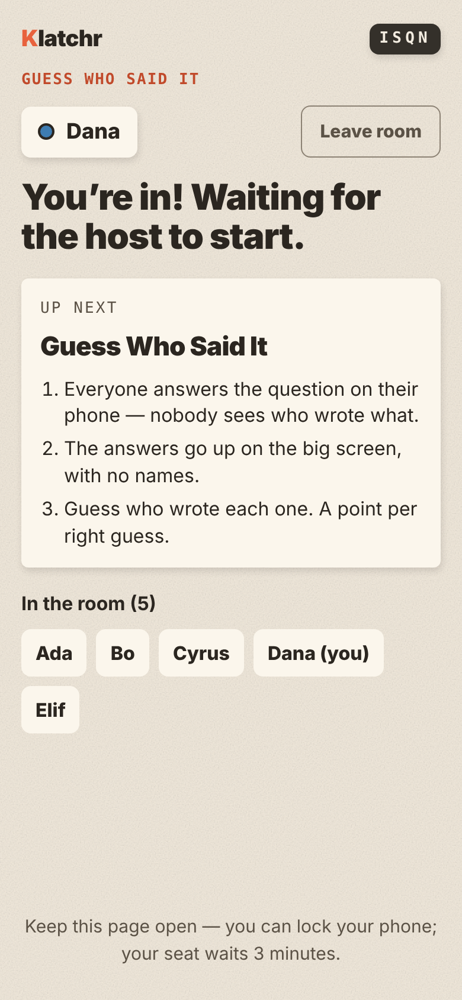
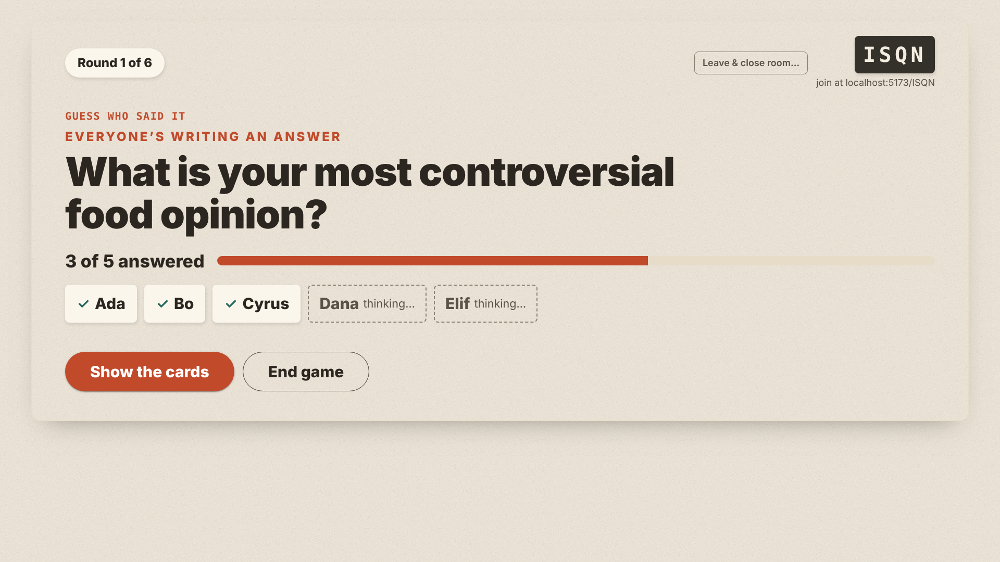
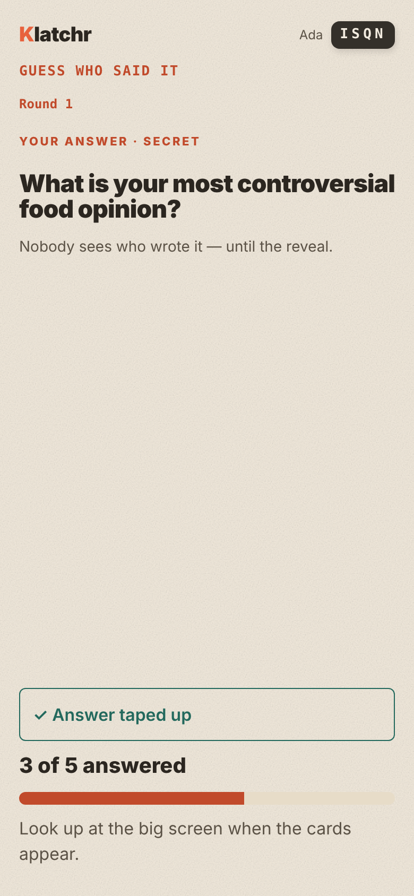
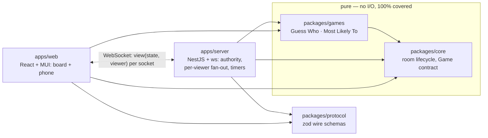

# Klatchr

[](https://github.com/ramazankarisan/klatchr/actions/workflows/gate.yml)


**A party-game platform for teams.** A host opens a room on a shared screen (a TV or a
laptop on a projector), everyone joins from their phone with a four-letter code, and the
group plays a short game together — an icebreaker for an offsite, a team meeting or a
remote call.

**Play it live:** <https://klatchr.duckdns.org> — open it on a laptop to host, then join
from two or three phones.

<!-- screenshots: docs/screenshots/ -->
| Shared screen | Phone |
| --- | --- |
|  |  |
|  |  |

## The games

- **Guess Who Said It** — everyone answers a prompt; the answers go up on the board with no
  names; each player guesses who wrote which. A point per right guess.
- **Most Likely To** — everyone votes for who in the room best fits the prompt; the board
  reveals the tally (never who voted for whom).

A host can play the built-in questions in one tap, or bring their own: pour in a themed
pack, reorder it, add custom questions. A question set is a session — it plays through once,
in order, then ends on the final standings.

## Why it is built the way it is

The interesting part is not the games — it is keeping a multiplayer game **honest and
alive** across a dozen unreliable phones.

- **Redaction is a correctness boundary.** Every game exposes
  `view(state, viewer)`: what *this* phone, or the shared screen, may see. The server never
  sends raw state. The host screen is the strictest viewer, because the whole room sees it.
  A leak is treated as severely as a crash: every game ships redaction tests for both
  viewers, and a fuzzer checks that changing one player's hidden answer never changes
  anyone else's view.
- **Pure game logic.** `packages/core` and `packages/games` are pure reducers —
  `(state, event) => Result` — with randomness, time and the round injected. That makes every
  rule unit-testable (100% line and branch coverage, enforced) and every fuzz failure an exact,
  replayable seed.
- **Property-based conformance.** A fast-check kit drives seeded event storms through each
  game's real reducer and views: it never throws, rejections are typed, input is never
  mutated, scores only go to seated players, and hidden data never leaks.
- **Built for flaky phones.** Players keep their seat for 3 minutes through a phone lock or a
  Wi-Fi blip; the server's heartbeat drops dead sockets, the client's watchdog replaces
  sockets that only *look* open, a second device takes a seat cleanly, and one bad client
  can't crash the process or flood a public server.
- **Parse at the boundary.** Every message is a zod schema in `packages/protocol`, parsed on
  both ends. Nothing from the wire is ever cast.

## Architecture



Dependencies point one way and are enforced by dependency-cruiser in the gate. More in
[ARCHITECTURE.md](ARCHITECTURE.md).

## Run it locally

Requires Node 22 and pnpm 10.

```bash
pnpm install
pnpm dev          # web :5173 on an in-browser mock room (bots play along) + server :8080
pnpm e2e          # the real stack in Playwright: one host + several phones in one test
```

To play against the real server locally, run `pnpm -C apps/server dev` and
`pnpm -C apps/web dev --mode e2e` (its `.env.e2e` points the web at `ws://localhost:8080`),
then open the web URL in a few browser windows — one hosts, the others join.

## Quality wall

`pnpm gate` is the definition of done — a fail-fast wall that runs locally (husky) and in CI
on every PR, together with the end-to-end suite:

purity of core/games · redaction + conformance tests present for every game · no casts at the
wire boundary · no hardcoded host · dependency allowlist · secrets scan · lint/format (biome)
· dead code (knip) · duplication (jscpd) · types · type coverage · module architecture
(dependency-cruiser) · production audit · license allowlist · tests with coverage thresholds.

| Layer | What it proves |
| --- | --- |
| Unit (vitest) | each reducer transition, including every rejection |
| Conformance (fast-check) | game invariants under seeded event storms |
| ws-integration | the real socket path: wire JSON, heartbeat, grace and reap, limits |
| E2E (Playwright) | a whole round across browser contexts, reloads and drops |
| `pnpm bots` | a crowd of real protocol clients against a running server |

## Built with an AI agent, under rules

Klatchr is developed with Claude Code working under written, enforced rules:

- **Plan before code** — research, a written plan in `docs/plans/plan-N.md`, then TDD.
- **`CLAUDE.md`** — a short root file plus one per area (`packages/`, `apps/server/`,
  `apps/web/`, `e2e/`) that loads only when the agent works there.
- **Backpressure** — the gate above, plus Claude Code hooks that refuse skipping it
  (`--no-verify`, pushing to `main`) and ask before an agent edits the wall itself.

The plans are the project's history: [docs/plans/](docs/plans/).

## Repository map

```
packages/core       room + player lifecycle, the Game contract, conformance + scenario kits
packages/games      one directory per game
packages/protocol   zod schemas for every client↔server message
apps/server         NestJS + ws gateway, room hub, sessions, bot soak tool
apps/web            React + MUI board and phone views
e2e/                Playwright multi-device rounds
docs/               deploy runbook, play-test checklist, plans and design history
```

Deploy: a single Docker container behind Caddy on a small VM — [docs/deploy.md](docs/deploy.md).
